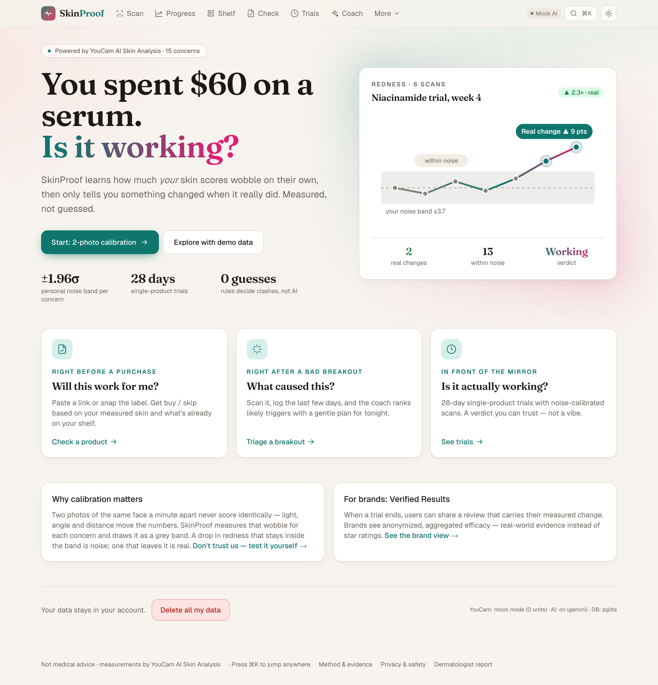
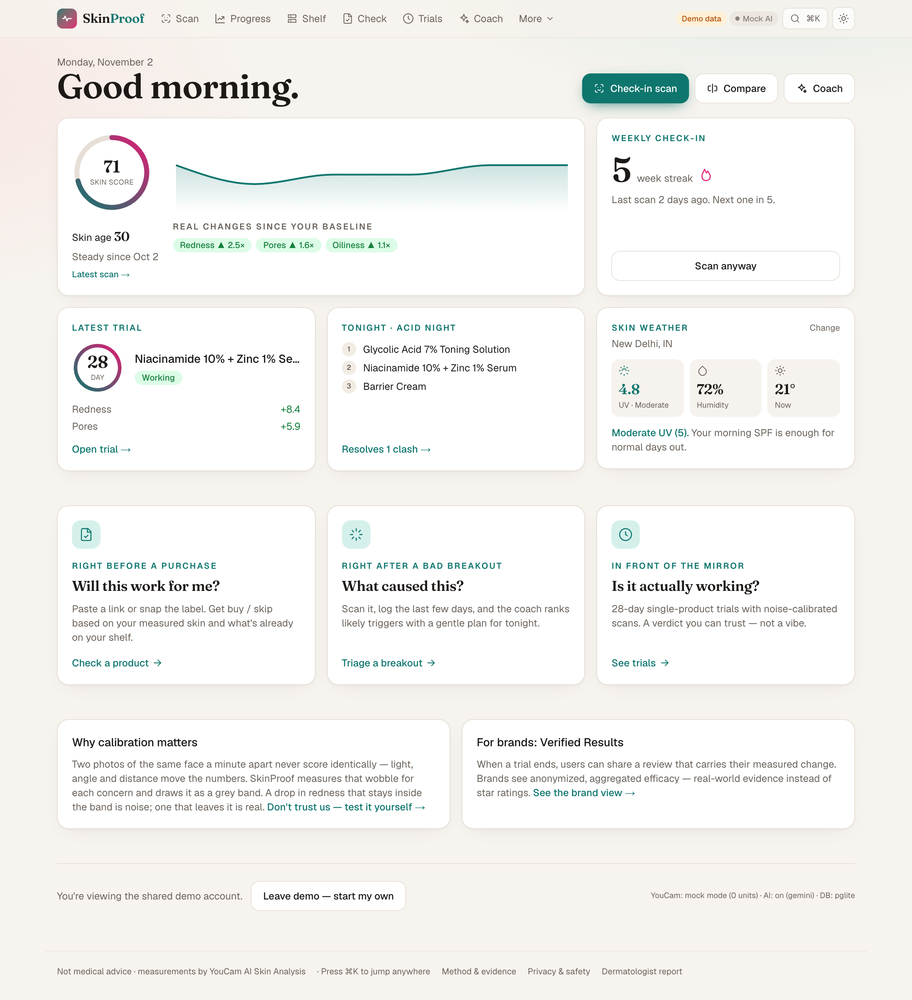
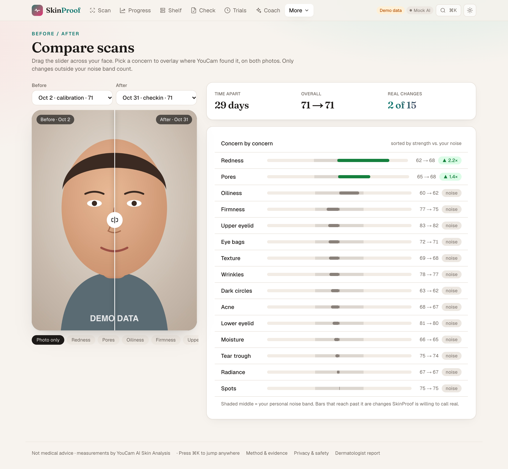
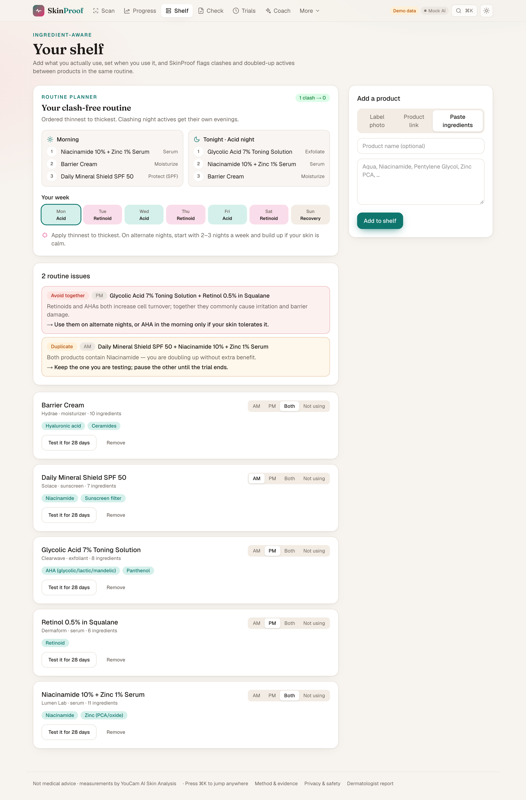
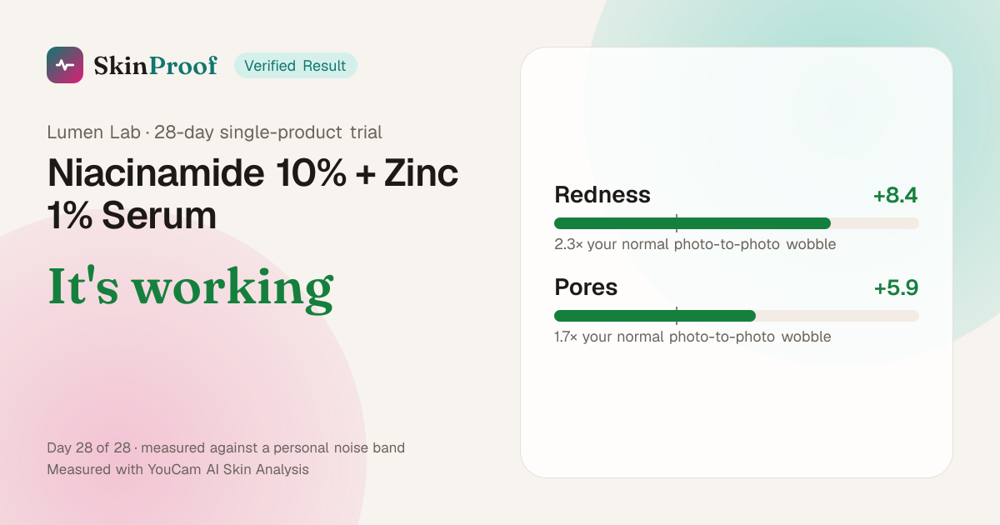
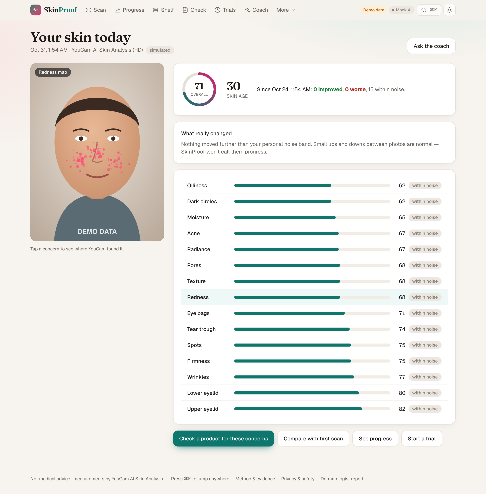
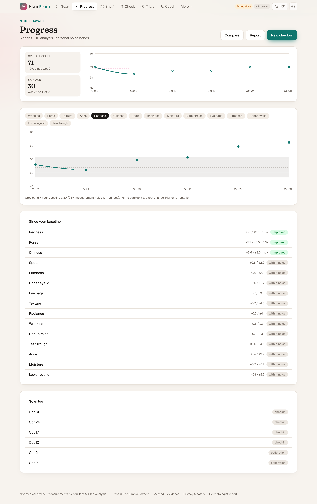
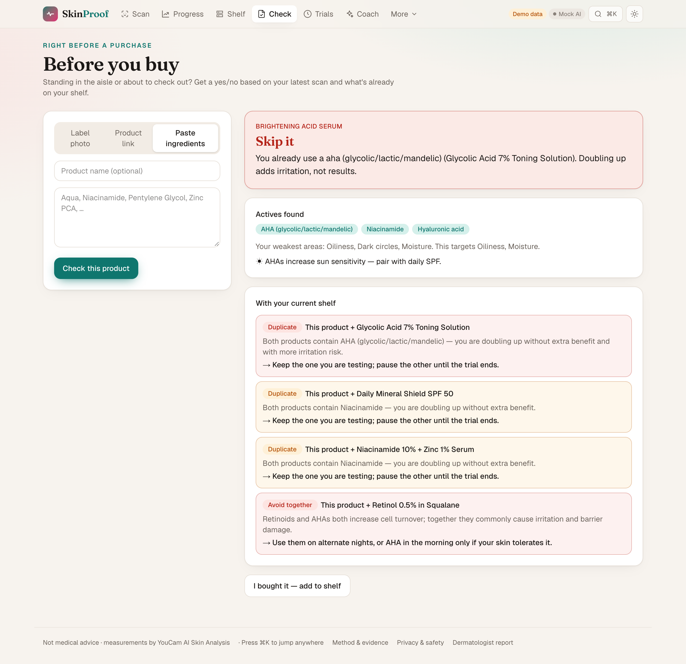
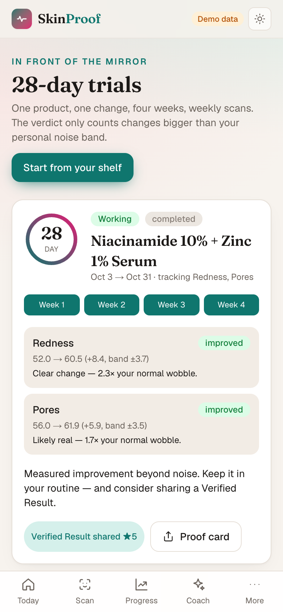

# SkinProof — is your skincare actually working?

> You spent $60 on a serum. Is it working? Nobody actually *measures* it. SkinProof does.

SkinProof is a measurement-first skincare co-pilot built on **YouCam AI Skin Analysis**. It learns how much *your* skin
scores wobble on their own (calibration), then only tells you something changed when the change is bigger than that
noise. Around that core: an ingredient-aware shelf with clash detection, a pre-purchase "buy / skip" check, 28-day
single-product trials with measured verdicts, breakout triage, an AI coach (tool-calling agent on the free Groq or Gemini tier), and
**Verified Results**: reviews that carry the reviewer's measured skin change, aggregated for brands.

**Track:** Skin AI · **YouCam API used:** AI Skin Analysis (SD / HD, 15 concerns + skin type, zone masks)

| Moment from the brief | SkinProof feature |
|---|---|
| "Right before a purchase" | **Before you buy**: label photo / link / pasted INCI → buy · buy with care · skip, based on your weakest measured concerns and your shelf |
| "Right after a bad breakout" | **Breakout triage**: breakout scan + 20-second diary → coach ranks likely triggers and gives a gentle plan for tonight |
| "In front of a mirror deciding whether a product is working" | **28-day trials**: one product, weekly scans, verdict against your personal noise band |



| Today dashboard | Before / after compare | Clash-free routine | Shareable proof card |
|---|---|---|---|
|  |  |  |  |

## How YouCam is used

`src/lib/youcam/client.ts` implements the documented S2S flow:

1. `POST /s2s/v2.0/file` → presigned upload slot → `PUT` the photo bytes
2. `POST /s2s/v2.0/task/skin-analysis` with all 16 `dst_actions` (`hd_*` when the photo's short side ≥ 1080px)
3. `GET /s2s/v2.0/task/skin-analysis/{task_id}` → `ui_score`, `raw_score`, `mask_urls` per concern

Scores, skin age and the per-concern masks are persisted (masks are copied before YouCam's 24h retention ends) and
drive everything else: noise bands, progress charts, trial verdicts, pre-purchase fit and the coach's tools.

## What makes it more than a wrapper

- **Noise calibration.** Two photos a minute apart → per-concern threshold `1.96 · |Δ|` (pooled across repeat calibrations). Changes inside the band are shown as *within noise*. See `src/lib/domain/noise.ts`.
- **Deterministic ingredient engine.** The LLM only *reads* labels and pages (structured output). Mapping INCI → actives → concerns and all clash rules are plain, tested tables (`src/data/`).
- **Single-variable trials.** One active trial at a time; verdicts `too_early → working / no_change / worsening` (`src/lib/domain/trial.ts`).
- **Agentic coach.** Tool-calling loop with 9 user-scoped tools (scan profile, history, noise-aware compare, shelf, product check, diary read/write, trials). It is told to never claim a change inside the noise band. Steps stream to the UI.
- **Verified Results for brands.** Consenting reviews carry measured deltas; brand view aggregates with a k ≥ 3 anonymity floor.
- **Proof, not promises.** A *Method & evidence* page where anyone can run tests with known answers: nothing changed (should stay in band), concealer (should be detected), flushed skin (should be detected). Test scans never touch real progress.
- **Plain-language confidence.** Every change is stated in noise bands: "Clear change, 2.4× your normal wobble".
- **Capture consistency.** A live light meter in the camera and a warning when lighting drifts from the calibration photos.
- **Useful beyond the app.** A printable dermatologist report, coach replies in 10 languages, installable on a phone.
- **Clash-free routine planner.** The shelf builds an ordered AM/PM routine and splits clashing night actives (e.g. retinoid vs. AHA) onto alternate evenings with a recovery night, using graph colouring over the same conflict rules. One tap applies the suggested slot changes. Pure and tested (`src/lib/domain/routine.ts`).
- **Before / after compare.** Drag a slider across any two scans, overlay one concern's YouCam zone mask on both photos, and see every concern's change drawn against your noise band.
- **Shareable proof card.** A finished trial renders a 1200×630 PNG (`next/og`) with the measured result: no photo, no name. Download it or share it through the phone's share sheet.
- **Skin weather.** Today's UV and humidity (Open-Meteo, fetched in the browser so your location never reaches the server), matched to the actives on your shelf and your weakest concerns.
- **Today dashboard.** Returning users land on their skin score trend, weekly check-in streak, trial progress, tonight's routine and skin weather. Light/dark/system themes, a ⌘K command palette, and a mobile "More" sheet that reaches every page.
- **Unit-aware.** Mock mode for development (0 units), an in-app unit budget meter, mode locked per user so SD/HD results are never mixed.

## Quick start

Requirements: Node ≥ 20.9 (tested on 22). No database install needed.

```bash
npm install
cp .env.example .env        # then fill in keys (see below) — optional for a first look
npm run setup               # applies migrations + seeds the clearly-labelled demo account
npm run dev                 # http://localhost:3000
```

- With **no keys at all** the app runs fully: YouCam runs in mock mode (simulated scores, 0 units) and data lives in an embedded Postgres (PGlite) at `./.data/pglite`. Click **"Explore with demo data"** on the home page.
- Add `YOUCAM_API_KEY` and set `YOUCAM_MOCK=false` for real analysis. Add a free `GROQ_API_KEY` (console.groq.com/keys) **or** `GEMINI_API_KEY` (aistudio.google.com/apikey) for label photos, product links and the coach.
- To use your own Postgres instead of PGlite, set `DATABASE_URL`. Migrations apply automatically on first request.
- PGlite allows one process at a time: stop `npm run dev` before running `npm run setup` / `db:seed` again.

### Environment variables

| Variable | Required | Purpose |
|---|---|---|
| `YOUCAM_API_KEY` | for live scans | YouCam API key (console → API Keys) |
| `YOUCAM_MOCK` | – | `true` = simulated results. Auto-on when no key is set |
| `YOUCAM_MODE` | – | `auto` (HD when photo ≥ 1080px) · `sd` · `hd` |
| `YOUCAM_UNIT_BUDGET` | – | Units available (default 1000) for the budget meter |
| `YOUCAM_BASE_URL` | – | Default `https://yce-api-01.makeupar.com` |
| `GROQ_API_KEY` | one of these two, for coach / photo / URL | Groq free tier (default models `openai/gpt-oss-120b`, vision `qwen/qwen3.8-27b`) |
| `GEMINI_API_KEY` | ↑ | Gemini free tier (default `gemini-3.6-flash`, falls back to 3.5 / 2.5 Flash when busy) |
| `LLM_PROVIDER` | – | `auto` (Groq if its key is set, else Gemini) · `groq` · `gemini` |
| `LLM_MODEL` / `LLM_VISION_MODEL` | – | Override the provider's default models |
| `LLM_BASE_URL` | – | Any other OpenAI-compatible endpoint |
| `DEV_TIME_TRAVEL` | – | `true` shows "skip ahead N days" on Trials for testing a 28-day trial in minutes (your account only, never the demo) |
| `SCANS_PER_USER_PER_DAY` | – | Live scans per user per 24 h (default 10, `0` = unlimited). Protects your units on a public URL |
| `AI_CALLS_PER_USER_PER_DAY` | – | Coach turns + label/URL reads per user per 24 h (default 60) |
| `DATABASE_URL` | on Vercel | Empty → embedded PGlite (local only) |
| `APP_URL` | – | Public URL |

### Scripts

`npm run dev` · `build` · `start` · `test` (vitest, 62 tests) · `typecheck` · `lint` · `db:generate` · `db:migrate` · `db:seed` · `setup`

## Deploy (Vercel + free Postgres)

1. Create a free Postgres database (e.g. [Neon](https://neon.tech)) and copy its connection string.
2. Import the repo in Vercel. Set these environment variables:
   - `DATABASE_URL`
   - `YOUCAM_API_KEY` and `YOUCAM_MOCK=false`
   - `GEMINI_API_KEY` (or `GROQ_API_KEY`)
   - `APP_URL` = your Vercel URL
   - keep `DEV_TIME_TRAVEL=false`
3. Deploy. Migrations run on the first request.
4. Seed the demo account once from your machine: `DATABASE_URL=<neon url> npm run db:seed`.
5. Lower `SCANS_PER_USER_PER_DAY` if you want to protect units further while judging is open.

PGlite (the zero-setup local database) can't run on serverless; the app tells you so if `DATABASE_URL` is missing on Vercel.

## Stack

Next.js 16 (App Router, Route Handlers, Cache Components) · React 19 · Tailwind v4 · Drizzle ORM · PostgreSQL / PGlite ·
sharp · Recharts · `openai` SDK as an OpenAI-compatible client for Groq / Gemini (tool calling, JSON-schema output, vision) · Zod · Vitest.

## Docs

- [`docs/architecture.png`](docs/architecture.png): system architecture
- [`docs/LLD.md`](docs/LLD.md): low-level design: schema, API contracts, sequences, algorithms
- [`DECISION.md`](DECISION.md): every decision and why
- [`FLOW.md`](FLOW.md): build log, step by step

## Screenshots

| Scan result with zone map | Progress with noise band | Before you buy | Trial verdict (mobile) |
|---|---|---|---|
|  |  |  |  |

## Privacy & safety

See the in-app **Privacy & safety** page (`/privacy`). Face photos are stored only in the user's account, served only to their owner, and deletable in one click
("Delete all my data"). API keys are server-only. Product URLs are fetched server-side with SSRF guards (public
IPs only, re-validated redirects, size and time caps). SkinProof is not a medical device; the coach escalates to a dermatologist for red-flag symptoms.

Demo data is synthetic and labelled as such in the UI (placeholder illustration, fictional brands).

## License

MIT, see [LICENSE](LICENSE).
